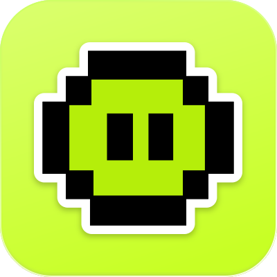

<div align="center">
  
  <h1>Stick It Up</h1>
  <p><strong>Give your website the kind of personality it deserves.</strong></p>
  <p>A curated collection of 65+ handcrafted vector, metallic chrome, and pixel art sticker components for React & Next.js with realistic 3D vinyl peel physics.</p>

  <p>
    <a href="https://www.npmjs.com/package/stick-it-up">
      
    </a>
    <a href="https://www.npmjs.com/package/stick-it-up">
      
    </a>
    <a href="LICENSE">
      
    </a>
    <a href="https://react.dev">
      
    </a>
    <a href="https://nextjs.org">
      
    </a>
    <a href="https://www.typescriptlang.org">
      
    </a>
  </p>

  <p>
    <a href="#-quick-start">Quick Start</a> •
    <a href="#-available-stickers">Stickers Catalog</a> •
    <a href="#-props-reference">Props</a> •
    <a href="#-local-development">Development</a> •
    <a href="#-contributing">Contributing</a> •
    <a href="#-license">License</a>
  </p>
</div>

---

## 🌟 Highlights

- 🎨 **65+ Handcrafted Stickers**: Specular chrome finishes, retro halftone stars, pixel art mascots (Nori, Pip, Kuro, Mochi), playful character doodles, and tactile badges.
- 🪄 **3D Vinyl Peel Physics**: Realistic hover tilt, subtle drop shadows, and elevation with a single `peel` prop.
- 🔒 **Zero ID Collisions**: Scoped SVG filter and gradient IDs powered by React's `useId()` so duplicate stickers never break each other.
- 🌲 **Tree-Shakeable & Lightweight**: Pure ESM and CommonJS dual bundle with full TypeScript definitions and zero runtime CSS dependencies.
- 🚀 **Dual Usage**: Use lightweight direct named component imports (`<FlameSticker />`) or dynamic name-based rendering (`<Sticker name="flame" />`).
- 🖥️ **Interactive Web Showcase**: Full Next.js showcase app featuring live dragging, interactive inspection modal, quickstart code generator, and instant SVG downloads.

---

## 📦 Installation

Install the package via your package manager of choice:

```bash
# npm (recommended: use @latest)
npm install stick-it-up@latest

# pnpm
pnpm add stick-it-up@latest

# bun
bun add stick-it-up@latest

# yarn
yarn add stick-it-up@latest
```

---

## 🚀 Quick Start

### 1. Named Component Import (Recommended for minimal bundle size)

Every sticker is exported as a standalone, tree-shakeable React component:

```tsx
import { FlameSticker, MetalSticker, NoriCoffeeSticker } from "stick-it-up";

export default function Hero() {
  return (
    <div className="flex items-center gap-6">
      {/* Basic usage with size in pixels */}
      <FlameSticker size={100} />

      {/* Interactive 3D peel on hover */}
      <MetalSticker size={120} peel />

      {/* Pixel mascot with custom sizing */}
      <NoriCoffeeSticker size={96} peel />
    </div>
  );
}
```

### 2. Dynamic Component (`<Sticker name="..." />`)

Need to dynamically display stickers based on state, props, or CMS data? Use the generic `<Sticker />` component:

```tsx
import { Sticker, type StickerName } from "stick-it-up";

const featured: StickerName[] = [
  "flame",
  "metal",
  "star-burst",
  "nori-coffee",
  "pip-rocket",
  "kuro-cool",
  "mochi-laptop",
];

export default function StickerGrid() {
  return (
    <div className="grid grid-cols-4 gap-4">
      {featured.map((name) => (
        <Sticker key={name} name={name} size={96} peel />
      ))}
    </div>
  );
}
```

### 3. Using Raw SVGs

All SVGs are also available directly in the `public/stickers/` folder for use in plain HTML or standard `` tags:

```html

```

---

## ⚙️ Props Reference

All sticker components accept standard SVG element props alongside custom sticker attributes:

| Prop | Type | Default | Description |
| :--- | :--- | :--- | :--- |
| `size` | `number \| string` | `100` | Symmetrical width and height in pixels (e.g., `96` or `"120px"`). |
| `peel` | `boolean` | `false` | Enables 3D vinyl peel hover physics (tilt, lift, and soft sticker shadow). |
| `name` | `StickerName` | — | Required **only** when using the generic `<Sticker name="..." />` component. |
| `width` | `number \| string` | — | Overrides `size` for explicit custom width. |
| `height` | `number \| string` | — | Overrides `size` for explicit custom height. |
| `className` | `string` | `""` | Additional CSS classes for rotation, positioning, or custom animations. |
| `style` | `React.CSSProperties` | — | Inline style overrides (automatically merged with peel animation styles). |
| `...props` | `React.SVGProps` | — | Any other standard SVG attributes (`role`, `aria-label`, `onClick`, etc.). |

---

## 🎨 Available Stickers (65 Total)

### 👾 Pixel Mascots (24 stickers)
Handcrafted retro pixel art characters in different activities:

| Character | Available Stickers |
| :--- | :--- |
| **Nori** | `<NoriCoffeeSticker />`, `<NoriCoolSticker />`, `<NoriHeadphonesSticker />`, `<NoriHeartSticker />`, `<NoriLaptopSticker />`, `<NoriRocketSticker />` |
| **Pip** | `<PipCoffeeSticker />`, `<PipDetectiveSticker />`, `<PipHeadphonesSticker />`, `<PipRocketSticker />`, `<PipThinkingSticker />`, `<PipWizardSticker />` |
| **Kuro** | `<KuroCoffeeSticker />`, `<KuroCoolSticker />`, `<KuroHeadphonesSticker />`, `<KuroHeartSticker />`, `<KuroLaptopSticker />`, `<KuroRocketSticker />` |
| **Mochi** | `<MochiCoffeeSticker />`, `<MochiCoolSticker />`, `<MochiHeadphonesSticker />`, `<MochiHeartSticker />`, `<MochiLaptopSticker />`, `<MochiRocketSticker />` |

### 🎭 Characters (17 stickers)
- `bad-cat` (`<BadCatSticker />`)
- `black-cat` (`<BlackCatSticker />`)
- `black-face` (`<BlackFaceSticker />`)
- `bunny` (`<BunnySticker />`)
- `cat` (`<CatSticker />`)
- `cat-cute` (`<CatCuteSticker />`)
- `cat-serious` (`<CatSeriousSticker />`)
- `cat-sit` (`<CatSitSticker />`)
- `curious-globe` (`<CuriousGlobeSticker />`)
- `dog` (`<DogSticker />`)
- `face` (`<FaceSticker />`)
- `fish` (`<FishSticker />`)
- `luffy-hat` (`<LuffyHatSticker />`)
- `pink-cat` (`<PinkCatSticker />`)
- `pink-cat-stamp` (`<PinkCatStampSticker />`)
- `red-cat` (`<RedCatSticker />`)
- `yellow-cat` (`<YellowCatSticker />`)

### ⚡ Chrome & Aesthetic Shapes (9 stickers)
- `flame` (`<FlameSticker />`)
- `metal` (`<MetalSticker />`)
- `flame-star` (`<FlameStarSticker />`)
- `blob-burst` (`<BlobBurstSticker />`)
- `star-burst` (`<StarBurstSticker />`)
- `devil-cone` (`<DevilConeSticker />`)
- `folded-paper` (`<FoldedPaperSticker />`)
- `icy-fleur` (`<IcyFleurSticker />`)
- `goo` (`<GooSticker />`)

### 💎 Symbols & Emblems (15 stickers)
- `app-badge` (`<AppBadgeSticker />`)
- `badge-smiley` (`<BadgeSmileySticker />`)
- `berries` (`<BerriesSticker />`)
- `blueberry` (`<BlueberrySticker />`)
- `cherry` (`<CherrySticker />`)
- `coffee` (`<CoffeeSticker />`)
- `cone` (`<ConeSticker />`)
- `cosmic-eye` (`<CosmicEyeSticker />`)
- `cosmic-pill` (`<CosmicPillSticker />`)
- `eye-splat` (`<EyeSplatSticker />`)
- `flower` (`<FlowerSticker />`)
- `heart` (`<HeartSticker />`)
- `japan-badge` (`<JapanBadgeSticker />`)
- `japan-flag` (`<JapanFlagSticker />`)
- `nazar` (`<NazarSticker />`)
- `peace-hand` (`<PeaceHandSticker />`)
- `red-berry` (`<RedBerrySticker />`)
- `sparkles` (`<SparklesSticker />`)
- `sparkle-trio` (`<SparkleTrioSticker />`)
- `spiral` (`<SpiralSticker />`)

---

## 💻 Local Development

The repository is structured as an npm workspaces monorepo:

```
components/
├── app/                      # Next.js showcase web application
│   ├── page.tsx              # Landing page with interactive drag & drop
│   └── stickers/             # Full stickers catalog & documentation
├── components/               # Landing page UI sections
├── packages/
│   └── stickers-react/       # The "stick-it-up" npm package source
│       ├── src/
│       │   ├── stickers/     # All 65 sticker React components
│       │   ├── components/   # Generic <Sticker /> wrapper
│       │   └── utils/        # usePeel hover hook
│       └── tsup.config.ts    # Package build config (CJS, ESM, DTS)
└── public/
    └── stickers/             # Raw SVG assets
```

### Running Locally

1. Clone the repository:
   ```bash
   git clone https://github.com/Sam721166/stick-it-up.git
   cd stick-it-up
   ```

2. Install dependencies:
   ```bash
   npm install
   ```

3. Build the sticker package:
   ```bash
   npm run build:package
   ```

4. Start the Next.js development server:
   ```bash
   npm run dev
   ```

5. Open [http://localhost:3000](http://localhost:3000) to view the live showcase and `/stickers` for the full catalog.

---

## 🤝 Contributing

Contributions from designers and developers are warmly welcomed!

- **Submit Artwork**: Have a cool vector decal or sticker concept? Read our [Contributing Guide](CONTRIBUTING.md) to learn how to add your SVG and React component.
- **Request a Sticker**: Have an idea for a sticker you'd like to see added? [Open a Sticker Request issue](https://github.com/Sam721166/stick-it-up/issues/new?labels=sticker-request&title=[Sticker+Request]:+).
- **Report Bugs**: Encounter an issue with sizing, Peel effects, or imports? [Open an issue on GitHub](https://github.com/Sam721166/stick-it-up/issues).

---

## 💖 Support & Sponsorship

Stick It Up is an independent, 100% free open-source project. If these stickers made your website or app more enjoyable, consider backing future packs and ongoing maintenance:

- **[GitHub Sponsors](https://github.com/sponsors/Sam721166)**: Monthly or one-time sponsorship with profile badges.
- **[Buy Me a Coffee](https://buymeacoffee.com/samirande_)**: Send a quick coffee ($5) via Apple Pay or card with zero setup.

---

## 📄 License & Fair-Use Terms

This project is licensed under the **Stick It Up Fair-Use & Community License** (v1.0, 2026).

### Summary of Terms:

- ✅ **Free & Encouraged**:
  - Install and use in personal projects, developer portfolios, and non-commercial web apps.
  - Study, fork, and explore the codebase to learn motion and UI engineering techniques.
  - Submit bug fixes, features, and new sticker designs back to the community via Pull Requests.

- ❌ **Restrictions**:
  - **No Commercial Paywalls**: You may **not** sell, license, or place this software, its sticker graphics, or derivative components behind a paid paywall, paid subscription, or commercial asset pack.
  - **No Competing Clones / Re-hosting**: You may **not** make minor or trivial modifications to this project and publicly host or republish it as your own competing sticker catalog or package.
  - **Artist Rights**: Character designs and artwork curated in this library remain the intellectual property of their original creators.

For the full legal text, please read the [LICENSE](LICENSE) file.

---

<div align="center">
  <p>Crafted with care by <a href="https://github.com/Sam721166">Samiran De</a> • If you enjoy Stick It Up, give it a ⭐️ on GitHub!</p>
</div>
